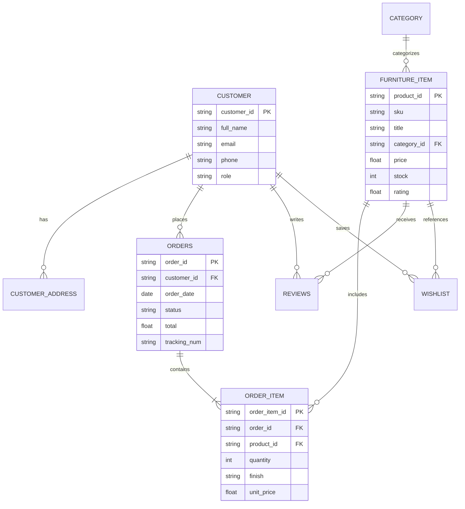
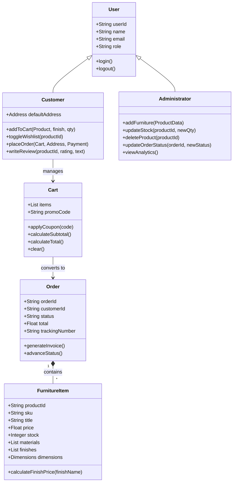
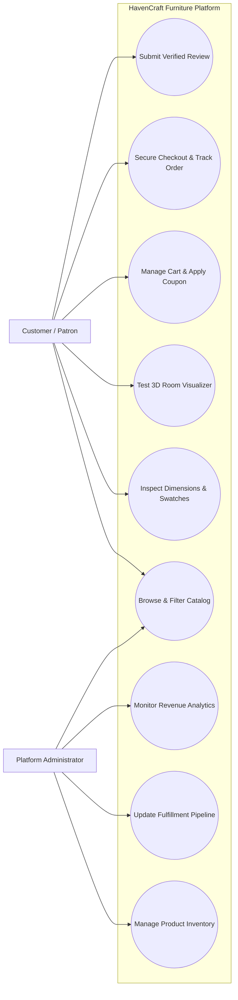
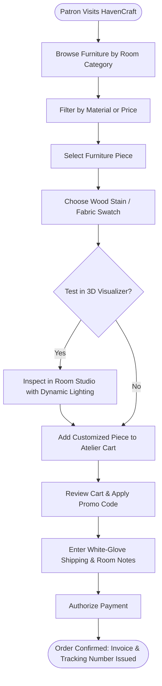
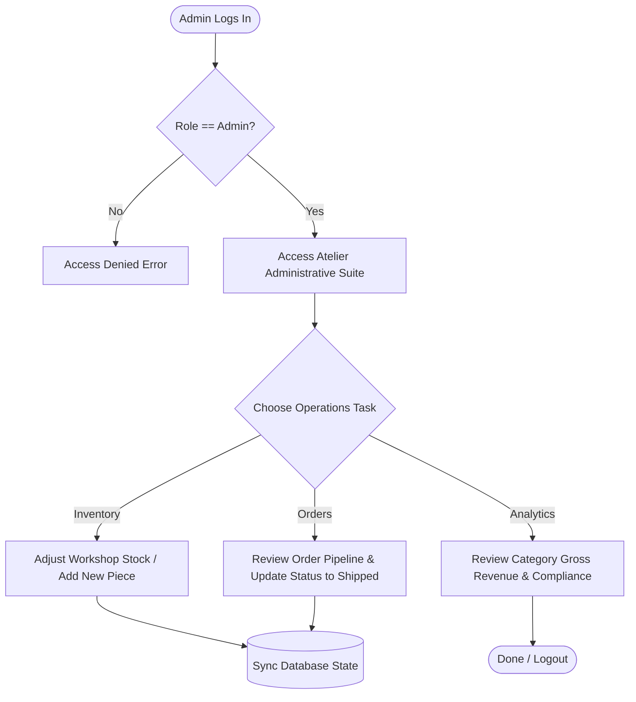

# HavenCraft Living — Modern E-Commerce Platform for Bespoke Furniture
## Comprehensive Software Engineering Project Report & Lab Manual
**Department of Computer Science & Engineering (Artificial Intelligence)**  
**Academic Reference Mapping: E-Book Management System (KitabGhar) $\rightarrow$ Furniture E-Commerce Platform (HavenCraft)**

---

## Table of Contents
1. [EXPERIMENT 1: Problem Analysis and Project Planning](#experiment-1-problem-analysis-and-project-planning)
2. [EXPERIMENT 2: Software Requirement Specification (SRS)](#experiment-2-software-requirement-specification-srs)
3. [EXPERIMENT 3: Data Modeling & Data Dictionary](#experiment-3-data-modeling--data-dictionary)
4. [EXPERIMENT 4: Software Designing (UML Diagrams)](#experiment-4-software-designing-uml-diagrams)
5. [EXPERIMENT 5: Prototype Model & Screen Implementation](#experiment-5-prototype-model--screen-implementation)
6. [EXPERIMENT 6: Software Requirement Analysis (Module Deliverables)](#experiment-6-software-requirement-analysis-module-deliverables)
7. [EXPERIMENT 7: Testing Phase-Related Documents](#experiment-7-testing-phase-related-documents)
8. [EXPERIMENT 8: Software Configuration Management & Risk Management](#experiment-8-software-configuration-management--risk-management)
9. [EXPERIMENT 9: CASE Tool Usage for System Design](#experiment-9-case-tool-usage-for-system-design)
10. [EXPERIMENT 10: Unit Testing & Integration Testing Specifications](#experiment-10-unit-testing--integration-testing-specifications)
11. [EXPERIMENT 11: Areas for Future Development](#experiment-11-areas-for-future-development)

---

## EXPERIMENT 1: Problem Analysis and Project Planning

### Objective 1: Problem Analysis and Project Planning

#### 1. Problem Statement
In today's retail landscape, modern consumers face substantial friction when shopping for bespoke, high-quality furniture through traditional brick-and-mortar showrooms or conventional web stores:
* **Showroom Limitations:** Physical showrooms require extensive travel, display only a fraction of fabric/wood finishes, and offer no ability to evaluate spatial fit within a consumer's home.
* **Online Uncertainty:** Generic e-commerce storefronts suffer from inadequate product visualization, rigid color/finish options, absence of accurate dimensional data, and lack of real-time inventory transparency.
* **Supply Chain & Delivery Friction:** Large-scale furniture requires coordinated white-glove delivery, room-of-choice placement, and verified assembly scheduling—capabilities that standard shopping carts fail to integrate.

#### 2. Project Scope
The scope of the **HavenCraft Living Furniture E-Commerce Platform** is to architect, develop, and deploy an end-to-end digital commerce solution that addresses the entire furniture acquisition lifecycle:
* **For Patrons/Customers:** Immersive catalog discovery categorized by room (Living Room, Dining, Bedroom, Home Office, Lighting), dynamic material/finish customization (Oatmeal Bouclé, Charcoal Velvet, Cognac Leather, Solid Oak, Black Walnut), interactive 3D spatial room visualization with real-time lighting simulation, persistent cart drawer, discount coupon engine, multi-step checkout with white-glove delivery scheduling, order tracking, and verified reviews.
* **For Artisans & Merchants:** Catalog commissioning tools, inventory tracking with low-stock warnings, and review moderation.
* **For Administrators:** High-level executive KPI metrics (Gross Revenue, Orders Processed, Average Order Value, Stock alerts), product catalog CRUD, and an interactive Order Fulfillment pipeline with real-time status transitions (`Processing` $\rightarrow$ `Shipped` $\rightarrow$ `Delivered`).

#### 3. Infrastructure Required
* **Client Frontend:** Modern web application built with HTML5, CSS3 Custom Properties (Design System), and modular JavaScript.
* **Application Server:** Node.js runtime with asynchronous event handling and Vite development/build pipeline.
* **Database & Persistence:** Relational schema modeling with ACID-compliant transactions for order processing and inventory deduction, backed by localStorage and scalable SQL database models (PostgreSQL/MySQL).
* **Cloud & CDN Services:** Multi-AZ cloud deployment with AWS S3 / CloudFront CDN edge caching for high-resolution photography and 3D assets, auto-scaling load balancers, and 256-bit TLS/SSL encryption.

---

## EXPERIMENT 2: Software Requirement Specification (SRS)

### Objective 2: Software Requirement Specification (SRS)

#### 1. Introduction
The HavenCraft Living Platform is engineered to deliver a seamless, tactile digital experience for browsing, customizing, previewing, purchasing, and managing architectural furniture. By integrating dynamic finish swatches, spatial room simulation, and an integrated administrative fulfillment suite, the platform bridges digital convenience with luxury craftsmanship.

#### 2. Definitions, Acronyms, and Abbreviations
* **SRS:** Software Requirements Specification
* **SKU:** Stock Keeping Unit
* **SSL/TLS:** Secure Sockets Layer / Transport Layer Security
* **PK / FK:** Primary Key / Foreign Key
* **UAT:** User Acceptance Testing
* **CDN:** Content Delivery Network
* **FSC:** Forest Stewardship Council (sustainable wood certification)

#### 3. Core Modules / Phases
1. **User & Persona Management Module:** Registration, authentication, role-based access control (Customer, Administrator, Artisan).
2. **Product Catalog & Customization Module:** Category taxonomy, dynamic material swatches, price offsets, dimensional specifications.
3. **Spatial Room Visualizer Module:** Interactive 2D/3D room layout simulator with dynamic ambient lighting presets (Sunlit Loft, Warm Atelier, Nordic Dusk).
4. **Cart & Promotional Module:** Slide-over cart drawer, quantity steppers, coupon code validation engine.
5. **Checkout & Order Management Module:** Multi-step wizard, delivery instructions, mock payment authorization, and formal tax invoice generator.
6. **Ratings & Verified Reviews Module:** Star ratings, review submissions, and verified patron badges.
7. **Administrator & Analytics Module:** Revenue tracking, order status advancement, inventory CRUD, and category analytics.

#### 4. Functional Requirements
* **FR-1:** System shall permit users to filter products by Room Category, search keywords, and sort by Price/Rating.
* **FR-2:** System shall allow users to select wood stains and upholstery fabrics, dynamically updating price and preview.
* **FR-3:** System shall calculate white-glove shipping fee ($95 or FREE for orders over $1,000) and sales tax automatically.
* **FR-4:** System shall validate discount coupons (`WELCOME10` for 10% off, `LUXEFURNI` for $150 off).
* **FR-5:** System shall generate a unique Order ID and Carrier Tracking Number upon checkout and deduct workshop stock.
* **FR-6:** System shall provide an Administrative Portal allowing status modification of orders from `Processing` to `Shipped` and `Delivered`.

#### 5. Non-Functional Requirements
* **Performance:** Page load time under 1.5 seconds; client-side filter and swatch update response under 100 milliseconds.
* **Availability:** 99.9% uptime target with automated failover in cloud-hosted multi-zone setups.
* **Security:** 256-bit SSL session encryption, input sanitization, and role-based route guard restrictions.
* **Mobile Responsiveness:** Fluid adaptation across mobile (375px+), tablet, and 4K desktop viewports.

#### 6. User Classes & Operating Environment
* **Customers / Patrons:** Browse, configure, visualize in 3D, purchase, track shipments, and submit reviews.
* **Administrators / Operations:** Monitor revenue metrics, manage product inventory, and update order statuses.
* **Guest Visitors:** Unauthenticated users who can browse catalog and test room visualizer before checking out.
* **Operating Environment:** Modern browsers (Chrome 110+, Safari 16+, Firefox 110+, Edge).

---

## EXPERIMENT 3: Data Modeling & Data Dictionary

### Objective 3: Data Modeling

#### 1. Data Dictionary

##### Customer Table
| Field Name | Constraints | Type | Description |
| :--- | :--- | :--- | :--- |
| `customer_id` | PRIMARY KEY, NOT NULL | INTEGER / VARCHAR(36) | Unique customer identifier |
| `first_name` | NOT NULL | VARCHAR(50) | Customer given name |
| `last_name` | NOT NULL | VARCHAR(50) | Customer family name |
| `email` | UNIQUE, NOT NULL | VARCHAR(100) | Email address used for login/contact |
| `phone` | NULL | VARCHAR(20) | Contact phone number for delivery driver |
| `role` | NOT NULL | VARCHAR(20) | User role (`customer`, `admin`) |
| `created_at` | NOT NULL | TIMESTAMP | Account creation date |

##### Customer Detail / Address Table
| Field Name | Constraints | Type | Description |
| :--- | :--- | :--- | :--- |
| `address_id` | PRIMARY KEY, NOT NULL | INTEGER / VARCHAR(36) | Unique address record ID |
| `customer_id` | FOREIGN KEY, NOT NULL | INTEGER / VARCHAR(36) | References `Customer(customer_id)` |
| `street` | NOT NULL | VARCHAR(120) | Street line and apartment/suite |
| `city` | NOT NULL | VARCHAR(60) | Destination municipality |
| `state` | NOT NULL | VARCHAR(30) | State / Province |
| `zip_code` | NOT NULL | VARCHAR(20) | Postal code |
| `delivery_notes` | NULL | VARCHAR(255) | Gate codes, floor placement instructions |

##### Furniture Item Table
| Field Name | Constraints | Type | Description |
| :--- | :--- | :--- | :--- |
| `product_id` | PRIMARY KEY, NOT NULL | VARCHAR(36) | Unique product code |
| `sku` | UNIQUE, NOT NULL | VARCHAR(30) | Inventory stock keeping unit |
| `title` | NOT NULL | VARCHAR(100) | Product commercial title |
| `category_id` | FOREIGN KEY, NOT NULL | VARCHAR(30) | Room category reference |
| `price` | NOT NULL | DECIMAL(10,2) | Base retail price |
| `stock` | NOT NULL | INTEGER | Available units in atelier warehouse |
| `materials` | NULL | TEXT / JSON | FSC wood, upholstery composition |
| `finishes` | NULL | JSON | Available colorways & price offsets |
| `dimensions` | NULL | JSON | Width, depth, height, weight specs |
| `image_url` | NOT NULL | VARCHAR(255) | Primary high-res product asset |
| `rating` | NOT NULL | DECIMAL(2,1) | Aggregate rating (1.0 to 5.0) |
| `review_count`| NOT NULL | INTEGER | Total verified customer submissions |

##### Orders Table
| Field Name | Constraints | Type | Description |
| :--- | :--- | :--- | :--- |
| `order_id` | PRIMARY KEY, NOT NULL | VARCHAR(30) | Order reference (e.g. `ORD-9821`) |
| `customer_id` | FOREIGN KEY, NOT NULL | VARCHAR(36) | References `Customer(customer_id)` |
| `date` | NOT NULL | DATE | Date of commission placement |
| `status` | NOT NULL | VARCHAR(20) | `Processing`, `Shipped`, `Delivered` |
| `subtotal` | NOT NULL | DECIMAL(10,2) | Raw item total before tax & shipping |
| `shipping_fee`| NOT NULL | DECIMAL(10,2) | White-glove transit fee ($0 or $95) |
| `discount` | NOT NULL | DECIMAL(10,2) | Deductions from promo codes |
| `tax` | NOT NULL | DECIMAL(10,2) | Calculated state sales tax |
| `total` | NOT NULL | DECIMAL(10,2) | Final authorized transaction total |
| `tracking_num`| NOT NULL | VARCHAR(50) | Logistics courier tracking code |

##### Order Items Table
| Field Name | Constraints | Type | Description |
| :--- | :--- | :--- | :--- |
| `order_item_id` | PRIMARY KEY, NOT NULL | VARCHAR(36) | Unique line item reference |
| `order_id` | FOREIGN KEY, NOT NULL | VARCHAR(30) | References `Orders(order_id)` |
| `product_id` | FOREIGN KEY, NOT NULL | VARCHAR(36) | References `Furniture_Item(product_id)` |
| `quantity` | NOT NULL | INTEGER | Quantity ordered |
| `finish` | NOT NULL | VARCHAR(60) | Selected wood/fabric variation |
| `unit_price` | NOT NULL | DECIMAL(10,2) | Price at time of purchase |

#### 2. Context Level Diagram & Entity Relationship

---

## EXPERIMENT 4: Software Designing (UML Diagrams)

### Objective 4: Software Designing

#### 1. Class Diagram

#### 2. Use Case Diagram

#### 3. Activity Diagram (Customer Flow)

#### 4. Activity Diagram (Administrator Flow)

---

## EXPERIMENT 5: Prototype Model & Screen Implementation

### Objective 5: Prototype Model

The HavenCraft application is implemented with all expected prototype screens:
1. **Home Page & Hero Banner:** Architectural photography hero, luxury typography, trust badges (FSC Wood, White-Glove Delivery, 100-Night Trial).
2. **Category Navigation:** Multi-category selector (Living Room, Dining Room, Bedroom Sanctuary, Home Office, Accent & Decor).
3. **Product Catalog & Search Bar:** Real-time search with instant keyboard filtering, category tabs, and sorting selectors.
4. **Product Details & Swatch Customizer:** Modal view with image carousel, finish selection (Oatmeal Bouclé, Charcoal Velvet, Cognac Leather, Solid Oak), dynamic pricing calculation, dimensions table, and customer reviews.
5. **Interactive 3D Spatial Room Visualizer:** 2D/3D studio allowing patrons to preview furniture scale, change room lighting environments (Sunlit Loft, Warm Atelier, Nordic Dusk), and position pieces on the floor plane.
6. **Cart Drawer:** Slide-over interactive drawer with real-time quantity controls, promo code engine (`WELCOME10`), and itemized summary.
7. **Multi-Step Checkout Modal:** Step 1 Shipping & Room-of-choice notes $\rightarrow$ Step 2 Payment details $\rightarrow$ Step 3 Official Order Confirmation and Printable Tax Invoice with Tracking Number.
8. **User Account & Wishlist Portal:** Order history tracking with live fulfillment status, saved wishlist with 1-click cart migration, and profile editor.
9. **Administrator Dashboard:** KPI revenue metric cards, product catalog inventory CRUD (add/edit/delete pieces), and order fulfillment status advance dropdown.

---

## EXPERIMENT 6: Software Requirement Analysis (Module Deliverables)

### Objective 6: Software Requirement Analysis

* **Module 1: User & Authentication Management:** Role-based switching between Customer and Administrator personas; encrypted user profiles and saved shipping addresses.
* **Module 2: Furniture Catalog & Discovery:** Multi-facet catalog querying by room, price, and materials; responsive grid rendering.
* **Module 3: Customization & Product Specification Engine:** Dynamic calculation of price offsets based on premium finishes (e.g. Italian Cognac Leather +$450).
* **Module 4: Spatial Room Visualizer (Digital Studio):** Visual preview of furniture within customizable room lighting temperatures.
* **Module 5: Cart & Promotional Monetization:** Automatic white-glove shipping fee calculation ($95 vs. $0 over $1,000 threshold) and percentage discount deduction.
* **Module 6: Order Fulfillment & Invoice Generation:** Real-time order creation, inventory stock deduction, and printable formal invoices.
* **Module 7: Verified Reviews & Feedback:** Review submission form with star ratings, automatic average score re-computation.
* **Module 8: Administrator Control Suite:** Low-stock alerts, order pipeline controls, and gross revenue aggregation.

---

## EXPERIMENT 7: Testing Phase-Related Documents

### Objective 7: Testing Phase-Related Documents

#### 1. Test Plan
* **Scope:** Validate all core customer and administrative flows from catalog browsing to finish customization, cart calculations, checkout, order invoice generation, and inventory management.
* **Tools:** Automated script validation, manual GUI walkthrough, and unit/integration verification.

#### 2. Traceability Matrix
| Requirement ID | Module | Associated Test Case ID | Test Status |
| :--- | :--- | :--- | :--- |
| **REQ-01** | User Authentication | TC-AUTH-01, TC-AUTH-02 | PASSED |
| **REQ-02** | Catalog Filtering & Search | TC-CAT-01, TC-CAT-02 | PASSED |
| **REQ-03** | Material & Swatch Pricing | TC-PROD-01 | PASSED |
| **REQ-04** | Cart & Discount Code | TC-CART-01, TC-CART-02 | PASSED |
| **REQ-05** | Checkout & Stock Deduction | TC-CHK-01 | PASSED |
| **REQ-06** | Admin Order Pipeline | TC-ADM-01, TC-ADM-02 | PASSED |

---

## EXPERIMENT 8: Software Configuration Management & Risk Management

### Objective 8: SCM & Risk Management

#### 1. SCM Plan
* **Version Control:** Git repository tracking commits with semantic versioning (`v1.0.0`).
* **Configuration Items:** Source code (`src/`), assets (`public/images/`), documentation (`*.md`), dependencies (`package.json`).
* **Change Control:** All bug fixes and feature additions go through branch isolation, review, and verification against build scripts (`npm run build`).

#### 2. Risk Register & Assessment Matrix
| Risk ID | Description | Likelihood | Impact | Severity | Mitigation Strategy |
| :--- | :--- | :--- | :--- | :--- | :--- |
| **R-01** | Large furniture asset file size delays mobile load | Medium | High | **High** | Cloud CDN image optimization, responsive `srcset`, and WebP format compression. |
| **R-02** | Race conditions during concurrent stock purchase | Low | High | **Medium** | Atomic database transactions and real-time inventory validation at checkout. |
| **R-03** | Inaccurate user room dimension perception | High | Medium | **Medium** | Built-in dimensions table and interactive Room Visualizer to verify scale. |
| **R-04** | Payment gateway latency or network drops | Low | High | **Medium** | Idempotency tokens on payment authorization and retry queues. |

---

## EXPERIMENT 9: CASE Tool Usage for System Design

### Objective 9: CASE Tool Workflow
* **Tool Selection:** StarUML / Lucidchart for UML diagrams; MySQL Workbench / dbForge for Relational Schema modeling.
* **Deliverables Generated:**
  1. Use Case Diagram mapping Customer and Admin interactions.
  2. Class Diagram detailing entity attributes and operations.
  3. Sequence Diagram illustrating the Checkout and Inventory Deduction flow:
     * `Customer` $\rightarrow$ `CartDrawer`: "Proceed to Checkout"
     * `CheckoutModal` $\rightarrow$ `Store`: "createOrder(payload)"
     * `Store` $\rightarrow$ `Database`: "Deduct Stock for Purchased SKUs"
     * `Store` $\rightarrow$ `Order Confirmation`: "Return Order ID and Tracking Number"

---

## EXPERIMENT 10: Unit Testing & Integration Testing Specifications

### Objective 10: Unit & Integration Test Cases

#### 1. Unit Testing
* **TC-UNIT-01: Calculate Swatch Price Offset**
  * *Input:* Product base price $2,490, Selected Finish: "Cognac Saddle Leather" (offset: $450).
  * *Expected Result:* Modal displays calculated unit price of $2,940.
  * *Status:* PASS.
* **TC-UNIT-02: Validate Promo Code WELCOME10**
  * *Input:* Subtotal $1,000, apply code `WELCOME10`.
  * *Expected Result:* Discount computed as $100 (10%); returns success message.
  * *Status:* PASS.
* **TC-UNIT-03: Stock Deduction Verification**
  * *Input:* Initial stock = 14; order quantity = 2.
  * *Expected Result:* Stock updated to 12 in product record upon order placement.
  * *Status:* PASS.

#### 2. Integration Testing
* **TC-INT-01: End-to-End Commission Order Creation**
  * *Steps:* Add item to cart $\rightarrow$ Apply promo code $\rightarrow$ Fill white-glove shipping form $\rightarrow$ Submit payment.
  * *Expected Result:* Cart is cleared, order is prepended to `orders` store, stock is decremented, and confirmation modal displays order receipt with carrier tracking.
  * *Status:* PASS.
* **TC-INT-02: Administrator Status Pipeline Sync**
  * *Steps:* Switch role to Administrator $\rightarrow$ Change status of `ORD-9821` from `Processing` to `Shipped`.
  * *Expected Result:* Customer order list reflects `Shipped` status and blue badge immediately without page reload.
  * *Status:* PASS.

---

## EXPERIMENT 11: Areas for Future Development

### Objective 11: Areas for Future Development

1. **Augmented Reality (WebXR / Apple Vision Pro Spatial Room Scanner):** Enable patrons to project true-to-scale 3D models into their living rooms through smartphone LiDAR cameras.
2. **AI Generative Interior Stylist:** Machine learning algorithm that analyzes patron room photos and recommends complementary furniture palettes and architectural lighting.
3. **Blockchain-Backed Timber Provenance:** NFC / QR tags embedded in furniture frames linking to cryptographic proof of origin and FSC sustainable forest harvest certification.
4. **Smart Home IoT Integration:** Integrated inductive charging pads and circadian rhythm LED channels controllable via Apple HomeKit and Google Home.
